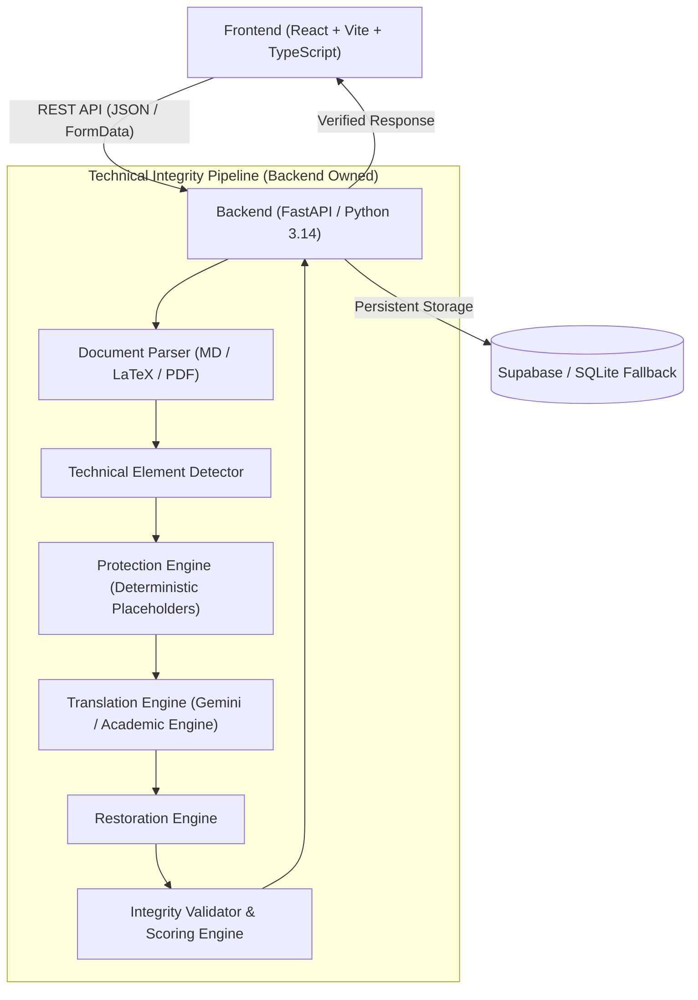

# TechSetu Architecture Specification

## Overview
**TechSetu** ("Translate Knowledge. Preserve Science.") is an AI-powered technical translation and integrity verification platform designed for STEM education. Its core mission is to enable students to study complex scientific material in their preferred Indian language (starting with Hindi) without compromising equations, numerical values, scientific units, code snippets, citations, or technical terminology.

## Core Architectural Principle
> **The language can change. The science must not.**

## High-Level System Architecture



## Component Breakdown

### 1. Frontend Layer (`frontend/`)
- Built with React, Vite, TypeScript, and Vanilla CSS.
- **Landing Page**: Value proposition, scientific visual elements, 3-pillar explanation ("Understand", "Preserve", "Verify"), interactive workflow diagram.
- **Translator Workspace**: Side-by-side scientific comparison, KaTeX formula renderer, real-time element counter badges, academic vs. student-friendly mode toggles, one-click STEM demo loader, failure demo trigger, download/copy actions.
- **Technical Integrity Panel**: Real-time breakdown of equation, number, unit, code, citation, and glossary preservation counts alongside the calculated Integrity Score.
- **Glossary Management**: Built-in terminology explorer + custom term adder.

### 2. Backend Layer (`backend/`)
- Built with Python 3.14 and FastAPI.
- **Document Parser**: Extracts clean text from Markdown, raw LaTeX, plain text, and uploaded PDFs (`pypdf`).
- **Technical Element Detector**:
  - *Equations*: LaTeX block (`$$...$$`, `\begin{equation}...\end{equation}`), inline LaTeX (`$...$`), and ASCII formulas (`F = ma`, `E = mc^2`).
  - *Numbers*: Floats, scientific notation (`5 \times 10^{-3}`), negatives, percentages, constants.
  - *Units*: SI and derived units (`kg`, `m/s^2`, `N`, `J`, `W`, `Pa`, `V`, `A`, `°C`, `K`, `Hz`, `Ω`, `mol`).
  - *Code Blocks*: Markdown code fences (` ```lang ... ``` `) and inline code tags (` `...` `).
  - *Citations*: Numeric references (`[1]`, `[1-3]`, `[12]`), author-year (`(Author, 2024)`), and `et al.`.
  - *Technical Terms*: Deterministic matching against the STEM Glossary (200+ terms).
- **Protection Engine**:
  - Replaces detected technical elements with unique deterministic placeholders:
    - `{{TECH_EQ_001}}`
    - `{{TECH_NUM_001}}`
    - `{{TECH_UNIT_001}}`
    - `{{TECH_CODE_001}}`
    - `{{TECH_CIT_001}}`
- **Translation Engine**:
  - Direct integration with Google Gemini via `google-genai` SDK using a strict academic prompt forbidding placeholder tampering.
  - Dual-engine fallback: Built-in scientific translation & transliteration engine for guaranteed offline operation.
- **Restoration Engine**:
  - Verifies presence and counts of all placeholders.
  - Replaces placeholders back with exact original technical representations.
- **Integrity Validator & Scoring Engine**:
  - Extracts elements from both original and translated text and performs strict set and count comparisons.
  - Detects semantic corruption (e.g. `9.81` vs `9.18`).
  - Calculates deterministic technical integrity score:
    $$\text{Score} = \sum w_i \times \frac{\text{Preserved}_i}{\text{Original}_i} \times 100\%$$

### 3. Data & Storage Layer (`supabase/`)
- Postgres schema tracking `documents`, `translations`, `glossary_terms`, and `validation_results`.
- Ephemeral placeholder processing is never stored in DB to guarantee high throughput and data privacy.
