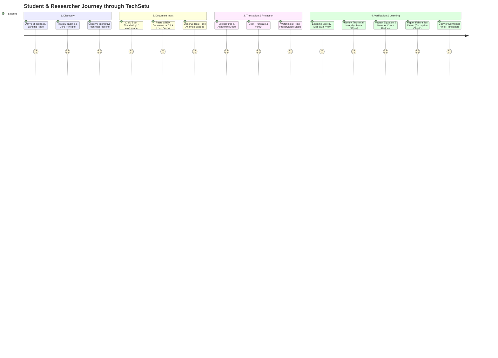

# TechSetu User Flow

## Step-by-Step Flow Details

1. **Landing Page**:
   - Hero: "Translate Knowledge. Preserve Science."
   - Subtitle: "Understand complex scientific and technical content in your language — without losing equations, numbers, units, code, or technical meaning."
   - CTAs: `Start Translating` (enters workspace) and `See How It Works` (scrolls to pipeline).
   - Value Pillars: "Understand", "Preserve", "Verify".

2. **Translator Workspace**:
   - Left Panel: Original STEM document with live character/word count and detected element badges (Equations, Numbers, Units, Code, Citations, Technical Terms).
   - Controls: Language pair selector (English -> Hindi), Mode selector (Academic / Student-Friendly), 'Load Physics/AI Demo', 'Clear', 'Translate & Verify' button.
   - Right Panel: Translated Hindi document with preserved LaTeX math rendering, formatted code blocks, and matched terminology.

3. **Integrity Panel**:
   - Large prominent Integrity Score badge (e.g. 100% or 98.7%).
   - Verification status cards for Equations, Numbers, Units, Code Blocks, Citations, and Glossary Terms.
   - Warnings & Mismatches disclosure (if any corruption occurred).
   - 'Test Validator' failure demo button (deliberately corrupts 9.81 to 9.18 to showcase validator catching the error).
